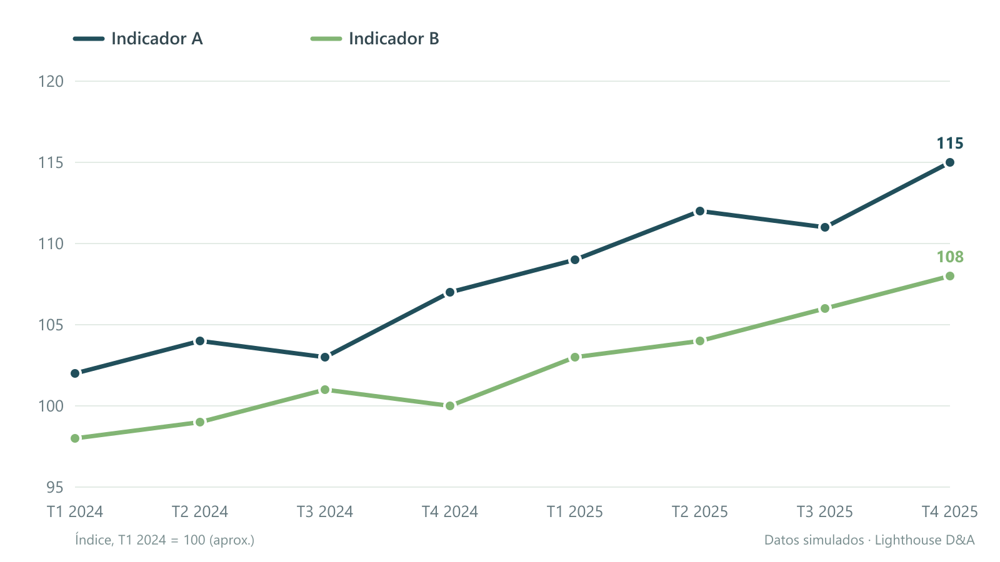
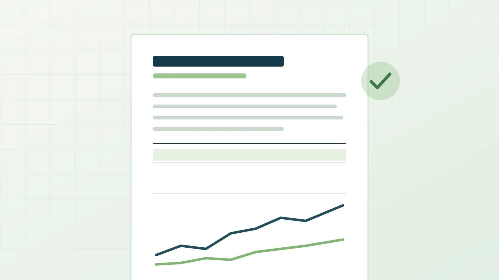

*Informe didáctico de Lighthouse D&A. Cada elemento aparece dos veces: primero el texto que se escribe en el archivo y, justo debajo, cómo se ve publicado. Los datos de los ejemplos son simulados.*

Este documento es a la vez una guía y un informe de ejemplo. Su archivo, `src/content/publicaciones/como-redactar-un-informe.md`, se puede abrir junto a esta página para comparar lo que se escribe con lo que se publica. Todo lo que ves aquí, incluidos los gráficos, sale de un único archivo Markdown.

## 1. Cómo está hecho un informe

Cada informe es un archivo de texto con extensión `.md` dentro de `src/content/publicaciones/`. El nombre del archivo forma la dirección web: `mi-informe.md` se publica en `/publicaciones/mi-informe/`. Usa minúsculas, números y guiones, sin acentos ni espacios.

El archivo tiene dos partes:

1. **Los metadatos**, entre dos líneas de tres guiones (`---`). Describen el informe: título, autor, fecha, categoría, portada.
2. **El cuerpo**, debajo, escrito en Markdown. Es el texto del informe.

```md
---
title: "Título del informe"
description: "Resumen de una o dos frases para listados y redes sociales."
author: equipo-lighthouse
publishedAt: 2026-11-12
category: economia
tags: ["inflación", "precios"]
coverImage: ../../assets/portadas/mi-informe.webp
coverAlt: "Descripción de la imagen de portada."
draft: true
demo: false
---

Primer párrafo del informe…
```

La forma más rápida de empezar es ejecutar `npm run nuevo -- mi-informe`, que crea el archivo con todos los campos y su carpeta de gráficos. Los campos obligatorios son estos:

| Campo | Qué escribir | Ejemplo |
| :--- | :--- | :--- |
| `title` | Título del informe, entre comillas | `"¿Más inversión significa más crecimiento?"` |
| `description` | Resumen de una o dos frases | `"Un ejercicio sobre…"` |
| `author` | Identificador del autor | `equipo-lighthouse` |
| `publishedAt` | Fecha en formato AAAA-MM-DD | `2026-11-12` |
| `category` | Una categoría existente | `economia` |
| `tags` | Lista de etiquetas entre corchetes | `["inflación", "precios"]` |
| `coverImage` | Ruta de la portada | `../../assets/portadas/x.webp` |
| `coverAlt` | Descripción de la portada | `"Gráfico abstracto…"` |

*Tabla 1. Campos obligatorios de los metadatos.*

Si falta un campo obligatorio o un valor no es válido, el sitio no se compila y el mensaje indica qué corregir. Mientras `draft: true`, el informe no se publica; solo se ve en la vista previa local.

## 2. La estructura recomendada

Los informes de Lighthouse D&A siguen un orden que ayuda al lector a encontrar lo que busca:

1. **Entradilla.** El primer párrafo, sin título. Resume la pregunta y el hallazgo en dos o tres frases. La plantilla lo muestra con una letra algo mayor.
2. **Contexto.** Por qué importa la pregunta.
3. **Datos y método.** Fuentes, período, unidades y tratamiento de los datos.
4. **Resultados.** Lo que muestran los datos, con tablas y gráficos.
5. **Limitaciones.** Lo que los datos no permiten concluir.
6. **Conclusión.** La respuesta a la pregunta inicial.

Las referencias bibliográficas no se escriben en el cuerpo: se añaden en los metadatos (`references`) y la plantilla las muestra al final, como en este informe.

## 3. Títulos y jerarquía

El título principal lo genera la plantilla a partir de `title`. **Nunca uses un solo `#`** en el cuerpo. Los niveles disponibles son tres:

```md
## Sección principal

### Subsección

#### Apartado dentro de una subsección
```

Cada `##` aparece automáticamente en el índice «En este informe». Deja siempre una línea en blanco antes y después de un título.

### 3.1 Así se ve una subsección

Las subsecciones (`###`) usan una letra sin remates para distinguirse de las secciones. Sirven para dividir una sección larga en partes.

#### Y así un apartado

El cuarto nivel (`####`) es el más discreto. Úsalo poco: si necesitas más niveles, probablemente la sección deba dividirse.

## 4. Formato del texto

Un párrafo es un bloque de texto separado de los demás por **una línea en blanco**. Pulsar Intro una sola vez no crea un párrafo nuevo. Dentro de un párrafo se usan estos caracteres:

| Quiero | Escribo | Resultado |
| :--- | :--- | :--- |
| Negrita | `**texto**` | **texto** |
| Cursiva | `*texto*` | *texto* |
| Enlace | `[texto](https://…)` | [texto](https://spec.commonmark.org/) |
| Nota al pie | `texto[^1]` | texto[^1] |
| Término técnico o código | `` `código` `` | `código` |
| Un asterisco literal | `\*` | \* |

*Tabla 2. Formato dentro de un párrafo.*

La nota al pie tiene dos partes: la marca `[^1]` en el texto y, en cualquier lugar del archivo (se recomienda al final), su contenido: `[^1]: Texto de la nota.` La plantilla las numera y las reúne bajo «Notas».

Usa la **negrita** para las dos o tres ideas clave de cada sección, no para frases completas. La *cursiva* sirve para términos extranjeros, títulos de obras y énfasis suave.

### 4.1 Convenciones tipográficas

Para que todos los informes se lean igual, escribe así los caracteres más frecuentes:

| Elemento | Forma correcta | Evitar |
| :--- | :--- | :--- |
| Comillas | «texto» y, dentro, “texto” | "texto" en el cuerpo |
| Decimales | 3,5 | 3.5 |
| Miles | 12 500 | 12,500 o 12.500 |
| Porcentajes | 12 % (con espacio) | 12% |
| Intervalos | 2019–2025 (raya corta) | 2019-2025 |
| Incisos | — como este — | - como este - |
| Fechas | 12 de noviembre de 2026 | 12/11/2026 |
| Puntos suspensivos | … (un carácter) | ... (tres puntos) |

*Tabla 3. Convenciones tipográficas de Lighthouse D&A.*

En los metadatos sí se usan comillas rectas ("…"), porque forman parte del formato del archivo.

## 5. Listas y citas

Las listas con viñetas empiezan con un guion y un espacio; las numeradas, con el número, un punto y un espacio. Para anidar, añade dos espacios al inicio:

```md
- Primer elemento
- Segundo elemento
  - Elemento anidado

1. Primer paso
2. Segundo paso
```

Resultado:

- Primer elemento
- Segundo elemento
  - Elemento anidado

1. Primer paso
2. Segundo paso

Una **cita destacada** empieza con el signo `>`. Reserva este recurso para la idea más importante de una sección:

```md
> Que dos indicadores crezcan juntos no significa que uno cause el otro.
```

> Que dos indicadores crezcan juntos no significa que uno cause el otro.

## 6. Tablas

Las tablas se escriben con barras verticales. La segunda fila separa el encabezado y decide la alineación de cada columna: `:---` a la izquierda (texto) y `---:` a la derecha (números). Debajo, en una línea en cursiva, va el pie con número, título y fuente.

```md
| Trimestre | Indicador A | Indicador B |
| :--- | ---: | ---: |
| T1 2024 | 102 | 98 |
| T2 2024 | 104 | 99 |

*Tabla 4. Indicadores A y B por trimestre. Fuente: datos simulados.*
```

Resultado, con los ocho trimestres:

| Trimestre | Indicador A | Indicador B |
| :--- | ---: | ---: |
| T1 2024 | 102 | 98 |
| T2 2024 | 104 | 99 |
| T3 2024 | 103 | 101 |
| T4 2024 | 107 | 100 |
| T1 2025 | 109 | 103 |
| T2 2025 | 112 | 104 |
| T3 2025 | 111 | 106 |
| T4 2025 | 115 | 108 |

*Tabla 4. Indicadores A y B por trimestre. Fuente: datos simulados para este ejemplo.*

Recomendaciones: no más de seis columnas, cifras alineadas a la derecha y el mismo número de decimales en toda la columna. En móvil, las tablas anchas se desplazan horizontalmente.

## 7. Gráficos estáticos (PNG)

Los gráficos se preparan fuera del sitio —en Python, R, Excel o cualquier otra herramienta— y se exportan como imagen. Para que todos encajen en la plantilla, deben cumplir esta especificación:

| Regla | Valor |
| :--- | :--- |
| Formato | PNG |
| Tamaño | exactamente 1600 × 900 píxeles |
| Carpeta | `src/assets/graficos/<nombre-del-informe>/` |
| Nombre del archivo | minúsculas y guiones: `indicadores-trimestrales.png` |
| Texto dentro del gráfico | 26 píxeles o más; sin título ni fuente |

*Tabla 5. Especificación de los gráficos estáticos.*

Se insertan con la sintaxis de imagen de Markdown y una línea de fuente debajo:

```md

*Fuente: datos simulados para este ejemplo. Nota: índices aproximados, T1 2024 ≈ 100.*
```

Cada parte tiene una función:

- **Entre corchetes `[ ]`**: la descripción del gráfico para quien no puede verlo. Di qué muestra y cuál es la conclusión, no solo «gráfico de líneas».
- **Entre paréntesis `( )`**: la ruta del archivo y, entre comillas, el número y el título con la forma `"Gráfico 1. Título"`.
- **La línea en cursiva**: empieza con `Fuente:`. Si añades `Nota:`, se muestra en una línea aparte.

Resultado:


*Fuente: datos simulados para este ejemplo. Nota: índices aproximados, T1 2024 ≈ 100.*

Si el archivo no mide 1600 × 900, no es PNG, falta la descripción, el título o la fuente, el sitio no se compila y el mensaje indica el archivo y la línea que hay que corregir.

## 8. Gráficos interactivos (HTML)

Cuando el lector gana algo al explorar los datos —consultar valores exactos, ocultar series, acercarse a un período—, se puede publicar un gráfico interactivo. Es un archivo `.html` exportado desde la herramienta de análisis:

- **Carpeta:** `public/interactivos/<nombre-del-informe>/`.
- **Un solo archivo autocontenido**, sin cargar librerías ni datos desde internet, de 5000 KB como máximo.
- **Fondo blanco** y diseño que se adapte al tamaño del marco.

Con Plotly en Python, por ejemplo:

```python
fig.write_html(
    "public/interactivos/mi-informe/indicadores.html",
    include_plotlyjs=True,   # incluye la librería: el archivo funciona sin conexión
    full_html=True,
)
```

Se inserta **con la misma sintaxis que un PNG**; solo cambian la ruta, que empieza por `/interactivos/`, y la extensión `.html`:

```md
")
*Fuente: datos simulados para este ejemplo.*
```

Resultado (pasa el cursor sobre los puntos o haz clic en la leyenda):

")
*Fuente: datos simulados para este ejemplo.*

El gráfico se muestra en un marco aislado, con la misma proporción 16:9 que los gráficos estáticos, y con un enlace para abrirlo a pantalla completa. Al imprimir la página, el marco se oculta. Si las cifras exactas importan, publica también la tabla.

## 9. Fotografías e ilustraciones

Las imágenes que no son gráficos —fotografías, mapas ilustrativos, esquemas— se guardan en `src/assets/publicaciones/<nombre-del-informe>/` y se insertan igual, pero sin título entre comillas. La línea en cursiva de debajo es el pie de imagen:

```md

*Pie de imagen. Fotografía: autor, año.*
```


*Ejemplo de pie de imagen. Ilustración: Lighthouse D&A.*

## 10. Errores frecuentes

- **Escribir el título con `#`.** La plantilla ya lo genera a partir de los metadatos.
- **Olvidar la línea en blanco** entre párrafos, antes de una lista o alrededor de una tabla. Sin ella, los elementos se pegan.
- **Pegar texto desde Word.** Puede arrastrar caracteres invisibles y comillas incorrectas. Pega como texto sin formato.
- **Escribir HTML o estilos** (colores, tamaños) en el cuerpo. La presentación la controla la plantilla.
- **Insertar gráficos con otro tamaño o formato**, o guardarlos en otra carpeta.
- **Dejar `demo: false`** cuando los datos son simulados. Los datos de ejemplo siempre llevan `demo: true`.

## 11. Antes de publicar

1. Revisa el informe con `npm run dev` en escritorio y en móvil.
2. Comprueba que cada cifra del texto coincide con su tabla o gráfico.
3. Verifica que cada gráfico y cada tabla tienen número, título y fuente.
4. Cambia `draft: true` por `draft: false`.
5. Ejecuta `npm run build` y `npm run test:site`; si algo falla, el mensaje indica qué corregir.

## Conclusión

Un informe de Lighthouse D&A es un único archivo de texto: los metadatos describen la publicación, Markdown estructura el contenido y la plantilla se encarga del diseño. Si sigues la estructura recomendada y la especificación de tablas y gráficos, cualquier informe nuevo tendrá el mismo aspecto profesional que este, sin tocar una línea de código.

[^1]: Así se ve una nota al pie. Las notas sirven para precisiones metodológicas o fuentes que interrumpirían la lectura.
