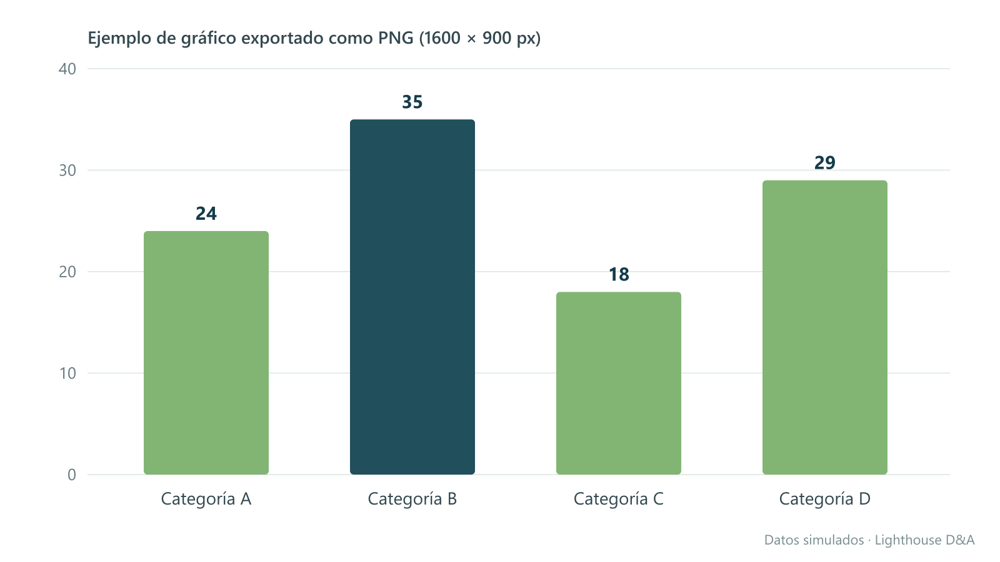

---
# ─── PLANTILLA DE INFORME ─────────────────────────────────────────────────────
# Crea un informe nuevo con:  npm run nuevo -- mi-informe
# El nombre del archivo forma la URL: /publicaciones/mi-informe/
# Guía con ejemplos de todo: /publicaciones/como-redactar-un-informe/ y docs/GUIA-PUBLICACIONES.md

# Obligatorios
title: "Título de una nueva investigación"
description: "Resumen breve (1–2 frases) que aparece en listados, buscador y redes sociales."
author: equipo-lighthouse            # identificador de un archivo en src/content/autores/
publishedAt: 2026-11-14               # AAAA-MM-DD
category: economia                    # economia | politicas-publicas | mercados | datos-y-metodos
tags: ["etiqueta uno", "etiqueta dos"]
coverImage: ../../assets/portadas/inversion-y-crecimiento.webp   # PNG, JPG o WebP en src/assets/portadas/
coverAlt: "Descripción accesible de la imagen principal."

# Opcionales
draft: true                           # cambia a false para publicar
demo: true                            # false solo cuando los datos sean reales y verificados
featured: false                       # true para destacarlo en la portada
# updatedAt: 2026-12-01
# originalPublishedAt: 2026-01-15
# readingTime: 10                     # se calcula solo si se omite
# relatedReports: ["inversion-y-crecimiento-demo"]
# seoTitle: "Título alternativo para buscadores"
# seoDescription: "Descripción alternativa para buscadores."
# datasets:                          # datos descargables (opcional), en public/datos/<informe>/
#   - label: "Nombre de los datos"
#     file: /datos/mi-informe/datos.csv
# references:
#   - title: "Título de la fuente"
#     author: "Apellido, N."
#     year: 2025
#     publisher: "Editorial o institución"
#     url: "https://…"
#   - "También se admite una referencia escrita como texto libre."
---

Primer párrafo: la entradilla. Resume en dos o tres frases la pregunta y el hallazgo principal. No repitas el título.

## Contexto

Explica por qué importa la pregunta. Usa **negrita** para las ideas clave, *cursiva* para términos y [enlaces a las fuentes](https://example.org/).[^1]

## Datos y método

Describe fuentes, cobertura, unidades, fecha de extracción y tratamiento de los datos.

- Fuente principal y período.
- Definición de las variables.

## Resultados

*Fuente: institución, año. Nota: aclaración metodológica opcional.*

| Indicador | 2024 | 2025 |
| :--- | ---: | ---: |
| Ejemplo simulado | 10,0 | 12,5 |

*Tabla 1. Título de la tabla. Fuente: institución, año.*

> Una cita destacada para la idea más importante del informe.

## Limitaciones

Expón los supuestos y lo que los datos no permiten concluir.

## Conclusión

Cierra con la respuesta a la pregunta inicial. Cambia `draft: false` cuando el informe esté revisado.

[^1]: Las notas al pie se numeran y se listan automáticamente al final del texto.
