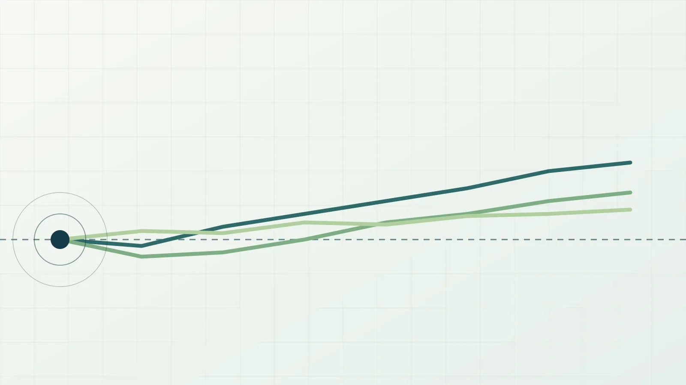

*Publicación de demostración para probar la plantilla editorial con Markdown simple. El ejemplo numérico es inventado y no describe ninguna serie oficial.*

Los números índice aparecen en casi todos los informes económicos: precios, producción, salarios o comercio exterior. Su atractivo es evidente, porque permiten comparar la **evolución relativa** de variables con unidades muy distintas. Pero esa misma flexibilidad facilita errores de lectura que conviene conocer.

## Qué es un índice con año base

Un índice expresa cada valor de una serie en relación con un período de referencia, al que se asigna el valor 100. Si una serie vale 100 en el año base y 112 tres años después, su nivel es un 12 % superior al de la referencia. El índice no dice nada sobre el nivel absoluto de la variable: una partida pequeña y otra enorme pueden tener el mismo índice.

> Un índice responde a «¿cuánto cambió respecto al punto de partida?», no a «¿cuánto hay?».

La elección del año base no altera las tasas de variación entre dos períodos, pero sí cambia la impresión visual de un gráfico. Un año base atípico, por ejemplo un período de crisis, puede exagerar la recuperación posterior.

## Un ejemplo inventado

La tabla siguiente usa valores ficticios para mostrar tres lecturas distintas de la misma serie.

| Período | Índice (base = 100) | Variación anual | Cambio acumulado |
| :--- | ---: | ---: | ---: |
| Año 1 | 100,0 | — | — |
| Año 2 | 104,0 | 4,0 % | 4,0 % |
| Año 3 | 98,8 | −5,0 % | −1,2 % |
| Año 4 | 108,7 | 10,0 % | 8,7 % |

*Tabla ilustrativa con datos simulados.*

Observa que una caída del 5 % seguida de un aumento del 10 % no deja la serie un 5 % por encima del año 2, sino un 4,5 %. Respecto al año 1, el cambio acumulado es del 8,7 %. Las variaciones porcentuales no se suman: se encadenan multiplicando sus factores.[^encadenar]

### Puntos frente a porcentajes

Cuando el índice pasa de 104 a 108,7, ha subido **4,7 puntos**, lo que equivale a un aumento del **4,5 %**. Confundir puntos con porcentajes es uno de los errores más frecuentes en titulares y presentaciones. La diferencia crece cuanto más se aleja el índice de 100.

## Lista de comprobación antes de publicar

1. Indica siempre el año base y la fuente de la serie.
2. Aclara si las cifras están en términos nominales o reales.
3. Distingue entre variación anual y cambio acumulado.
4. Usa «puntos» para diferencias de índice y «%» para tasas.
5. Evita comparar niveles de índices con bases distintas.

*Las tres líneas comparten el mismo punto de partida (índice = 100). Ilustración de Lighthouse D&A, sin datos.*

## Conclusión

Un índice bien presentado simplifica la comparación; uno mal explicado la distorsiona. Acompañar cada gráfico con su año base, su fuente y una frase sobre lo que el índice **no** indica es una costumbre sencilla que mejora la calidad de cualquier análisis.

[^encadenar]: Formalmente, el cambio acumulado entre los años 1 y 4 es (1 + 0,04) × (1 − 0,05) × (1 + 0,10) − 1 ≈ 0,087.
